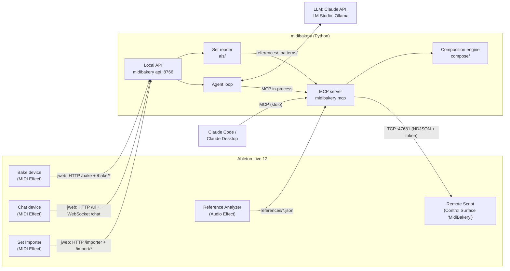

# MidiBakery – how the parts work together

MidiBakery builds EDM song sketches in Live from genre recipes, imported Live Sets and analyzed reference songs. It consists of six parts:

- **Remote Script** in Live: the only part that changes the Live Set.
- **Core** in Python: composition engine, `.als` importer, MCP server, agent and local API.
- **Bake device**: Max for Live MIDI effect: a whole song with one click, no model.
- **Chat device**: Max for Live MIDI effect for the chat.
- **Set Importer**: Max for Live MIDI effect that reads Live Sets (`.als`) into references and loops.
- **Reference Analyzer**: Max for Live audio effect that analyzes a reference song in the Arrangement.

## The parts

| Part | Where | Language | Started by | Talks to |
|---|---|---|---|---|
| Remote Script | `packages/remote_script/MidiBakery` → User Library/Remote Scripts | Python 3.11 (Live's interpreter, standard library only) | Live, when "MidiBakery" is the Control Surface | Live Object Model; listens on `127.0.0.1:47681` |
| MCP server | `packages/core/src/midibakery/mcp` | Python 3.12 | Claude Code / Desktop (`midibakery mcp`) | Remote Script |
| Local API | `packages/core/src/midibakery/api` | Python 3.12 | the Remote Script when it loads (`launcher.json`), or `uv run midibakery api` | Remote Script; LLM providers; Max devices |
| Bake, Chat, Set Importer | `packages/m4l` → Presets/MIDI Effects/Max MIDI Effect/MidiBakery | Max patch, `jweb`, Node for Max | Live, when the device is on a track | API |
| Reference Analyzer | `packages/m4l` → Presets/Audio Effects/Max Audio Effect/MidiBakery | Max patch, `v8`, `v8ui`, Node for Max | Live, when the device is on a track | Live API; writes `references/` |

### Remote Script

- Runs **inside** Live and executes atomic operations (`song.get`, `track.create`, `notes.apply`, `batch`, …) from the catalog in `catalog/ops.py` (`manifest.json` is its checklist).
- All Live access runs on Live's main thread: a socket thread accepts requests, `update_display()` works through them about every 100 ms. Every write is one undo step; a `batch` is one shared step.
- A failing `batch` or `arrangement.edit` reports what already ran but does not undo itself; the core undoes it (`compose/rollback.py`) so a change lands whole or not at all. Locators are restored from a snapshot instead.
- Ops that Live applies only on the next tick (`arrangement.locators`, `song.position`) run over several ticks and are not allowed inside a `batch`.
- On start it writes port and token to `bridge.json` in the MidiBakery folder. Several clients may connect; Live processes their jobs one after another. A client can subscribe to `state` events (tempo, scale, transport, what plays), which the chat's status line shows.

### Core

- **Composition engine** (`compose/`): drums, bass, chords and melody, aware of scale and meter; the same seed gives the same notes. `song.py` and `structures.py` turn a genre recipe ([GENRES.md](GENRES.md)) or a reference into a whole song; `rich.py` adds the `complexity: rich` layer on top (section variation, answer and layer voices derived from the lead and bass, drum ghost notes and fills, extra FX); named patterns are in [PATTERNS.md](PATTERNS.md). It only computes notes and knows nothing about Live.
- **Set reader** (`als/`): opens an `.als` (gzip XML, Live 11 and 12), expands clips the way Live plays them, assigns roles (`roles.py`), estimates key and sections, extracts repeating loops (`patterns.py`) and stores references and patterns in the MidiBakery folder (`library.py`). User patterns (`my_<set>_<role>_<n>`) are resolved by `compose/user_patterns.py`.
- **MCP server** (`mcp/server.py`): 16 tools. Reads: `get_session`, `get_clip`, `get_arrangement`, `get_reference`. Songs: `plan_song`, `apply_plan`. Parts: `compose`. Arrangement and song: `edit_arrangement`, `edit_notes`, `create_track`, `set_track`, `find_sounds`, `delete_clip`, `set_song`, `transport`, `undo`. The reference is [docs/user/MCP_SERVER.md](user/MCP_SERVER.md); `tests/test_docs.py` checks that it and every tool count in the docs match the server.
  - **plan_song** shows the model only `genre`, `length`, `progression`, `reference`, `loops_from`, `my_loops` and `seed`. The other `SongRequest` fields are hidden (`SONG_HIDDEN`) and use their defaults, with `SONG_DEFAULTS` turning on `set_tempo` and `fill_missing`. Tests that need the hidden fields build the server with `all_song_options=True`.
  - **Preview and apply:** `plan_song` (and `compose` with `preview=true`) changes nothing and returns a `plan_id`; `apply_plan` writes it and fails with `CONFLICT` if a target changed. Plans live in the process's memory (the last 32).
  - **Asking first:** deleting a clip and replacing notes ask through MCP elicitation; a rejection is `CANCELLED`. A client without elicitation gets a pending plan that only `apply_plan` runs.
  - **Arrangement clips by name:** clip tools take `arrangement_clip` (index or name, e.g. "Drop Bass") instead of `slot`. `compose` then rewrites the clip over its whole length.
- **Agent loop** (`agent/`): a conversation with Claude (Anthropic API), LM Studio or Ollama that calls **the same** MCP tools in-process. Local models get compact schemas and results (`compact_tools`, `COMPACT_RESULTS`); tool schemas plus system prompt stay under 16,000 characters (`tests/test_agent.py`). Safeguards in `loop.py`: a claimed change without a tool call or an unretried failed write gets one hint; the same failure three times, six failed rounds or 24 tool rounds stop the message (`STUCK`).
- **Local API** (`api/`, `127.0.0.1:8766`): the gateway for the Max devices, started by the Remote Script and stopped with Live.
  - `GET /ui`, `WS /chat`: the chat page and the agent (events `text`, `thinking`, `tool_call`, `tool_result`, `plan`, `confirm`, `live_state`, `done`, `error`).
  - `GET /bake`, `/bake/options`, `POST /bake/run`: the Bake device (`bake.py`: `build_song` and `apply_song` without a model; *Again* deletes the last baked song's clips and locators and bakes another seed at its place, its tracks stay; a failure undoes the deletion).
  - `GET /importer`, `/import/scan|preview|run|queue|pick|library|patterns`, `DELETE /import/{reference}`: the Set Importer.
  - `GET /models`, `/auth/anthropic`, `/update`, `/health`.
  Port and token are in `api.json`; every request needs the token.

### Max devices

- **Bake**, **Chat** and **Set Importer** show a page from the API in `jweb`; the token travels in the URL fragment. Live passes no keyboard to `jweb` and its dropdowns do not open, so the Chat device has native controls on the right (model menu, input field, Pop out) and the importer page works with clicks only. `node.script` (`midibakery-bake.js`, `midibakery-chat.js`, `midibakery-importer.js`, all on `midibakery-node.js`) finds the API through `api.json` and reloads the page when the token changes.
- **Reference Analyzer**: `v8` finds the longest audio clip on its track; `node.script midibakery-reference.js` decodes it (`afconvert` on macOS, WAV elsewhere) and `reference-analysis.js` computes per-bar energy in four bands, kick, key and sections. Unwarped clips are first warped onto Live's grid. Results go to `references/<hash>.json`, where `get_reference` reads them. Neither the API nor the Remote Script is needed.

## Which process hosts what

| Process | Started by | What runs in it | Connections |
|---|---|---|---|
| **Ableton Live** | you | Remote Script; Max for Live with the four devices | listens on `:47681` |
| **Max Helper** (child of Live) | Live/Max | Chromium for `jweb` | → `:8766` |
| **node** per `node.script` | Node for Max | API discovery, file decoding | → `:8766` |
| **`midibakery api`** | the Remote Script or you | API, agent, engine and an in-process MCP server | listens on `:8766`; → `:47681`; → LLM |
| **`midibakery mcp`** (one per Claude session) | Claude app | MCP server over stdio | → `:47681` |

A `midibakery mcp` runs the code of the folder its Claude session started in; sessions in a worktree use that worktree.

## A typical flow

"Build me a house song" in the Chat device: the page sends the text over WebSocket; the agent asks the LLM, which calls `plan_song`; the server reads the session, the engine plans sections, tracks and notes, and the page shows a timeline with **Apply**. Apply calls `apply_plan`, which creates missing tracks, writes the clips in batches and sets locators.

## Installer and updates

- **Package:** `packaging/build_app.py` freezes `midibakery` with Python, the Remote Script and the built devices (PyInstaller). `packaging/macos/build_pkg.py` and `packaging/windows/build_setup.py` build installers that install for the current user and run `midibakery install`. Not signed yet. CI builds them and tests install, update and uninstall.
- **Updates:** Cloudflare Worker and R2 on `updates.klirrwerk.com` (`services/updates`). The app trusts only an Ed25519-signed manifest and a matching SHA-256.

## Where to look when something goes wrong

All in `~/Library/Application Support/MidiBakery/` (Windows `%APPDATA%\MidiBakery\`):

| File | Contents |
|---|---|
| `bridge.json`, `api.json` | port and token of the Remote Script and the API |
| `api.log` | every user message and tool call with errors |
| `device-bake.log`, `device-chat.log`, `device-importer.log`, `device-reference.log` | the devices |
| `references/`, `patterns/` | analyzed and imported references, imported loops |
| `launcher.json`, `installed.json` | how Live starts the API; every path `install` wrote |
| `settings.json`, `update.json` | settings, update status |
| Live's `Log.txt` | the Remote Script (`MidiBakery: …`) |

`uv run midibakery ping` checks the connection to the Remote Script.

## Security in brief

- Everything binds to `127.0.0.1`; Remote Script and API require a random token from a file only your user can read. Logs redact it.
- Updates open an installer only with a valid signature and checksum; the check sends version, system, architecture and channel (`midibakery update --disable` turns it off).
- Claude receives session information (track names, notes, tempo). With LM Studio or Ollama everything stays local.
