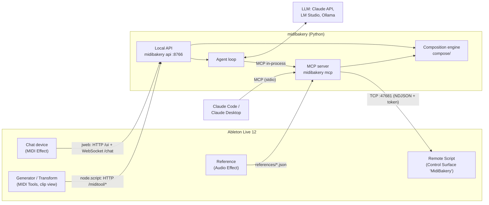

# MidiBakery – how the parts work together

MidiBakery consists of five parts:

- **Remote Script** in Live: controls the Live Set.
- **Core** in Python: composition engine, MCP server, agent and local API.
- **Chat device**: Max for Live device for the chat.
- **Generator** and **Transform**: two Max for Live MIDI Tools in the clip view.
- **Reference**: Max for Live audio effect that analyzes a reference song in the arrangement.

Only the Remote Script changes the Live Set; all other parts talk to it or to the API. The one exception: the MIDI Tools return their notes through Live's own MIDI Tool mechanism.

## The parts

| Part | Where | Language | Started by | Talks to |
|---|---|---|---|---|
| Remote Script | `packages/remote_script/MidiBakery` → User Library/Remote Scripts | Python 3.11 (Live's own interpreter, standard library only) | Live, when "MidiBakery" is selected as Control Surface | Live Object Model (LOM); accepts connections on `127.0.0.1:47681` |
| MCP server | `packages/core/src/midibakery/mcp` | Python 3.12 | Claude Code / Desktop (`midibakery mcp`, one process per session) | Remote Script |
| Local API | `packages/core/src/midibakery/api` | Python 3.12 | the Remote Script when it loads (`launcher.json`) or you: `uv run midibakery api --provider …` | Remote Script; LLM providers; Max devices |
| Chat device | `packages/m4l` → Presets/MIDI Effects/Max MIDI Effect/MidiBakery | Max patch, `jweb` (HTML/JS), Node for Max | Live, when the device is on a track | API |
| Generator / Transform | `packages/m4l` → MIDI Tools/Max Generators or Max Transformations | Max patch, `v8`, Node for Max | Live, when the tool is selected in the clip view | API |
| Reference | `packages/m4l` → Presets/Audio Effects/Max Audio Effect/MidiBakery | Max patch, `v8`, `v8ui`, Node for Max | Live, when the device is on a track | Live API; writes `references/` |

### Remote Script: the only hand on the Live Set

- Runs **inside** Live and executes atomic operations, for example `song.get`, `track.create`, `notes.apply`, `device.insert` or `batch`. The catalog is defined in `catalog/ops.py`, the matching checklist in `manifest.json`.
- All LOM access runs on Live's main thread. A socket thread accepts requests, and `update_display()` works through them about every 100 ms.
- Every writing operation is one undo step; a `batch` is a single shared undo step.
- A failing `batch` or `arrangement.edit` stops and reports what already ran (`completed`) but does not undo itself: undoing a step that changed nothing would revert the user's previous action. The core undoes it (`compose/rollback.py`), for plans, songs, master chains, `run_batch`, `edit_arrangement` and `compose_takes`, so a change lands whole or not at all. Locators are the exception: each is its own undo step and a timed-out one may still land, so the core restores them from a snapshot instead of counting undo steps.
- Live applies some changes only on the next tick, such as a new playback position. Ops like `arrangement.locators` and `song.position` therefore run over several ticks: the executor continues them once per `update_display()` and replies when Live shows the change. They do not run inside a `batch`.
- On start it writes port and token to `~/Library/Application Support/MidiBakery/bridge.json` (readable only by you). Clients read this file and authenticate with the token.
- Several clients at once are allowed: the MCP server of Claude Code and the API, for example. Live processes their jobs one after another.
- **Events:** A client can send `{"subscribe": ["state"]}`. Then `update_display()` reads a compact state about every 200 ms (tempo, time signature, scale, transport, selection, what is playing, starting or stopping per track) and sends it as a `state` event whenever it changes. Polling instead of LOM listeners: there is nothing to register and unregister when tracks, clips or the set change. The API follows these events and shows them in the chat's status line.

### Core: engine, MCP server, agent, API

- **Composition engine** (`compose/`): drums, bass, chords, melody and transformations. It is aware of scale and meter, and the same seed produces the same notes. It only computes notes and knows nothing about Live.
- **MCP server** (`mcp/`): provides 40 tools for Claude. The schemas come from the op catalog, composition tools call the engine, and everything that changes Live goes to the Remote Script through the bridge client. The reference of every tool is [docs/user/MCP_SERVER.md](user/MCP_SERVER.md); `tests/test_docs.py` checks that it and the tool counts in the docs match the server. By task:
  - read: `get_session` (song, tracks, devices, clips, plus locators and the arrangement clips of every track), `get_clip`, `get_arrangement`, `get_mixer`, `get_rack`, `get_device_parameters`, `get_drum_pads`, `find_browser_items`, `get_reference`
  - session and clips: `set_song`, `transport`, `create_track`/`update_track`/`delete_track`, `create_clip`/`update_clip`/`delete_clip`, `launch_clip`, `create_scene`/`fire_scene`, `edit_notes`, `undo`, `run_batch`
  - devices and mixer: `insert_device`, `load_browser_item`, `set_device_parameter`, `write_clip_envelope`, `update_mixer`, `create_return_track`, `update_rack`, `measure_master`
  - arrangement: `edit_arrangement` (create, copy, move, swap, delete clips; set and delete locators), `compose_takes`
  - composition: `compose`, `transform_notes`, `plan_changes`, `plan_song`, `plan_master`, `plan_loudness`, `apply_plan`
  - **Arrangement clips by name:** Where a tool needs a clip (`compose`, `transform_notes`, `delete_clip`, `move_clip`/`swap_clips` in `edit_arrangement`), you give `arrangement_clip` instead of `slot`: its index or its name ("Groove Bass"; case does not matter, part of the name is enough if it is unique). `compose` then replaces the notes over the whole clip length. A clip can only be moved if it is not trimmed and not a loop; no clip lands on top of another (`CONFLICT`).
  - **Parts of a clip:** `transform_notes` takes `half` (`first` / `second`) or `from_bar` / `to_bar` (bars of the clip, 1 = its first) and changes notes only there; `transpose` has `semitones` (chromatic, 12 = octave) or `steps` (scale degrees), never both.
  - **Preview and apply:** `preview=true` on `compose` or `plan_changes` changes nothing and returns a diff with a `plan_id`; `apply_plan` writes it in one undo step. If a target clip has changed since planning, it fails with `CONFLICT`. A plan that was already applied reports `already_applied` instead of failing. `plan_song` plans a whole song (see `docs/GENRES.md`); it too is only written with `apply_plan`. The same goes for `plan_master`, a master chain of EQ Eight, Glue Compressor and Limiter with the documented values of the genre (`docs/GENRES.md`), in two undo steps. `measure_master` reads the loudness that the device MidiBakery Loudness Meter measures on the master per BS.1770 and writes twice per second to `meter.json` in the MidiBakery folder; `reset=true` creates `meter-reset` there, and the device deletes it and measures again. `plan_loudness` uses this to plan one round towards the genre's target loudness (input gain of the Limiter, `docs/GENRES.md`); `apply_plan` sets it and resets the meter. Deleting tracks and clips and replacing notes ask first; a rejection comes back as `CANCELLED`. A client without elicitation cannot ask: the call is not run but returned as a pending plan (`not_applied`, `plan_id`) that only `apply_plan` executes, after checking that tracks and clips are unchanged. Plans live in the memory of the process that made them (the last 32) and are lost on a restart, on purpose: `apply_plan` checks every plan against Live anyway.
  - **Take lanes:** `compose_takes` puts 2 to 8 variants of a part (`hook`, `melody`, `bass`, `chords`, `drums`) over the same chords into separate take lanes of one track in the arrangement (Live 12.2+), one undo step.
  - Tool budget for local models: tool schemas plus system prompt stay under 36,000 characters (checked in `tests/test_agent.py`), currently about 35,800 – the limit is almost reached. New tools must share existing schemas or free up space elsewhere.
- **Agent loop** (`agent/`): a conversation with an LLM, that is Claude via the Anthropic API, LM Studio or Ollama. It calls **the same** MCP tools, only in-process instead of over stdio. Claude Code and the chat device thus have exactly the same capabilities.
  - **Providers:** `anthropic` (default `claude-sonnet-5-5`; Opus 5.5 and Haiku 5.5 selectable), `lmstudio` (OpenAI-compatible server, `LMSTUDIO_HOST`, default `127.0.0.1:1234`, default model `google/gemma-4-e4b`) and `ollama` (`OLLAMA_HOST`, default `127.0.0.1:11434`, default model `qwen3:8b`). The app reads the Claude key from the Keychain (macOS) or the Credential Manager (Windows); `ANTHROPIC_API_KEY` and an `ant auth login` profile work too.
  - **Compact mode** (automatic for `lmstudio` and `ollama`, `compact=True`): all tools, but with short descriptions and lean schemas (`compact_tools`: no titles, bounds or discriminator, description only the first sentence; `if_exists` is hidden so small models do not overwrite without being asked) and shorter results (`COMPACT_RESULTS`: `get_session` as a few lines of text with free slots). The first message of a conversation brings the session along right away; every message carries a language reminder (German or English, otherwise "Reply in the language of this message"). Arguments a tool does not know are named instead of silently dropped (with "did you mean …?"), and nesting invented by models is lifted (`lift_nested`).
  - **Safeguards** (`loop.py`): If a local model claims a change without having called a tool, or a write tool fails and is not retried, it gets a hint once per message; an empty answer is asked about once. The same failure three times or six rounds with only errors end the message with the code `STUCK`; after 24 tool rounds it ends as well. A change rejected by the user (`CANCELLED`) does not count as an error.
  - **UI tools:** The chat page may trigger `apply_plan` and `undo` itself (buttons Apply, Undo); the model learns about it with the next message and does not apply twice.
  - Two system prompts: `SYSTEM_PROMPT` (full) and `SMALL_SYSTEM_PROMPT` for 8k context. `tools=small` or `--small` also takes only 12 tools, `tools=reduced` or `--reduced` 13 (`REDUCED_TOOLS`, `SMALL_TOOLS` in `agent/tools.py`).
  - **LM Studio** loads a model on first use with its default context (often 4k or 8k), too small for the tools. The provider detects this and suggests `lms load <model> -c 32768`. The model menu lists loaded models (without embedding models) from LM Studio and Ollama; if neither is reachable, they are simply missing.
  - The server process writes every user message and every tool call (input shortened, result ok/error) with a timestamp to the log (`midibakery.agent`), see `api.log` below.
- **Local API** (`api/`, `127.0.0.1:8766`): the gateway for the Max devices. The Remote Script starts it as a separate process when Live loads it, and stops it with Live. It does not run in Live's Python: it needs Python 3.12 and packages outside the standard library. If an API is already running on the port, for example started by hand, that one stays.
  - `GET /ui`: the chat page (no secrets, `Cache-Control: no-store`)
  - `WS /chat`: the agent in the chat (query `provider`, `model`, `tools`); events `ready`, `text`, `thinking`, `tool_call`, `tool_result`, `plan`, `confirm`, `live_state`, `done`, `error`; messages `user`, `tool`, `confirm_reply`, `cancel`, `reset`
  - `GET /models`: the model selection (Claude models plus reachable local ones)
  - `GET|PUT|DELETE /auth/anthropic`: check, save, delete the Claude key; it is never sent back
  - `GET /update`, `POST /update/install`: update status and installation
  - `GET /license`, `POST /license/{trial|activate|deactivate}`: license
  - `POST /miditool/generate` and `/miditool/transform`: the engine for the MIDI Tools
  - `GET /health`: version, process ID, state of Live, update, license
  Port and token are in `api.json`; every request needs the token. If the license check is active and the license is not valid, the chat answers with `LICENSE_REQUIRED` before the model.

### Chat device

- A MIDI effect on any MIDI track; MIDI passes through unchanged.
- On the left, `jweb` (embedded browser) shows the chat page `/ui`. The token is in the URL fragment `#token=…`, which the browser never sends to the server.
- The chat page has: model menu, **Stop**, **Undo** (reverts the last change in Live), **Key** (only for Claude models), **Copy** (the whole conversation to the clipboard; a click on a single answer copies it), **New** (forget the conversation), a status line with the Live state, plan cards with **Apply** (note diff as a piano roll, a timeline for songs) and the banners for update and license. Local models need no key.
- On the right are native Max controls, because Live does not pass the keyboard on to `jweb` and dropdowns do not open in it:
  - **Model menu** (`umenu`): The page fills it with the list from `/models`, and the selection goes back as `model_index`.
  - **Input field** (`textedit`): Enter (or the Send button) sends the text as `chat_input` to the page, then the field gets focus back.
  - **Pop out** opens the same page in the browser.
- `node.script midibakery-chat.js` reads `api.json`, gives `jweb` the URL and sends it again until the page reports "loaded". If the token changes, for example when the API restarts, it reloads the page automatically.

### Generator and Transform (MIDI Tools)

- They appear in the clip view under **Generate** or **Transform** and work on the selected time range in the clip's scale.
- Live requires a **synchronous** answer per apply cycle, but the notes come from the API over HTTP. That is why the embedded `v8` code works in two passes:
  1. **Answer immediately:** with a cached result, otherwise with "change nothing".
  2. **Send the request:** The request goes to the API through `node.script midibakery-miditool.js`, as a Max dictionary rather than a message, because the notes of a clip are too large for that.
  3. **Trigger again:** When the answer arrives, it is cached, and the tool triggers itself once more, outside Live's apply call. Live then takes the result.
- **Generator:** In Live a generator can only add. **Replace** (default: on) therefore clears the time range first through the Live API, once per apply cycle. Within a cycle, that is when turning knobs or using Dice, Live always replaces its own intermediate result itself.
- **Transform:** The operation works on note IDs, so properties like probability are kept. If it changes nothing, the reason is shown in the status line.
- These tools do not use the Remote Script. They get the notes from Live and give them back to Live; the API only computes.

### Reference (Audio Effect)

- Sits on the audio track with the reference song. The `v8` code uses the Live API to find the longest audio clip in the track's arrangement and reads file, position, start marker and warp markers.
- `node.script midibakery-reference.js` decodes the file with `afconvert` (22.05 kHz mono) and analyzes it in `reference-analysis.js`, for warped clips on Live's beat grid from the warp markers, for unwarped ones on its own grid (tempo from the strongest eighth-note pulse, downbeat where the lows rise): energy in four bands per bar, kick from recurring rises in the lows, key from chroma and bass, sections in 8-bar steps with names (Intro, Build, Drop, Break, Outro).
- The **Genre** menu (Auto or one of `plan_song`) sets section names and phrase length and resolves half or double tempo. Four **Sensitivity** fields (0–100, default 50; Kick, Lows, Mids, Hats, each at the height of its track in the view) control how finely the song is split: their mean acts like a single knob (at 100 every change found is a section, lower values merge similar neighbors), their ratio weights the bands. **Lock** moves all fields together. The analysis runs again as soon as the fields are at rest. The changes inside a merged section stay in the analysis as `phrases`. An unwarped clip is first warped to Live's grid (set tempo unchanged).
- The result is shown in a `v8ui` and saved to `references/<hash>.json`; the MCP tool `get_reference` reads it. **Set Locators** sets locators at the sections one after another, **Remove Locators** removes all locators in the clip's range. Live sets and removes locators only at the playback position and snaps them to the visible grid, hence a task with ticks that recognizes new and vanished locators by their IDs; the transport must be stopped.
- Neither the API nor the Remote Script is needed.

## Which process hosts what

| Process | Started by | What runs in it | Ports / connections |
|---|---|---|---|
| **Ableton Live** | you | Remote Script (Live's Python); Max for Live with the patches of the three devices and the `v8` code of the MIDI Tools | listens on `127.0.0.1:47681` |
| **Max Helper (Renderer)** (child of Live) | Live/Max | Chromium for `jweb`: the chat page and its WebSocket | → `:8766` |
| **N4M PM** → one **node** per `node.script` (children of Live) | Node for Max | `midibakery-chat.js` or `midibakery-miditool.js`: discovery via `api.json`, HTTP of the MIDI Tools | → `:8766` |
| **`midibakery api`** | you (terminal) | local API **plus** agent loop, composition engine and its own MCP server instance, which the agent calls directly in-process | listens on `127.0.0.1:8766`; → `:47681`; → LLM (Claude API, LM Studio `:1234`, Ollama `:11434`) |
| **`midibakery mcp`** (one per Claude Code / Desktop session) | Claude app | MCP server for Claude over stdio, with its own engine | → `:47681`, only on the first tool call |

So the MCP code runs several times: in the API for the chat and as a separate process per Claude session. All instances are clients of the same Remote Script, which processes their jobs in Live one after another. A `midibakery mcp` runs with the code of the folder in which the Claude session was started; sessions in a worktree therefore use that worktree's state.

## Three typical flows

**1. Claude Code composes:** "Put four bars of house drums on track 1."

1. Claude calls the MCP tool `compose` with `kind: "drums"`.
2. The MCP server reads the session via `song.get` and `tracks.list` (tempo, scale, Drum Rack pads), and the engine creates the notes.
3. The MCP server sends a `batch` with `clip.create` and `notes.apply` to the Remote Script.
4. Live creates the clip in a single undo step.

**2. Chat in the device:** the same request, typed into the chat device.

1. `textedit` sends `chat_input` to the page, and the page sends it to the API over WebSocket.
2. The agent asks the selected LLM, and the LLM calls `compose` with `kind: "drums"`.
3. From here on it is the same path as in flow 1, only in-process.
4. For destructive changes the page asks "Apply / Cancel".

**3. MIDI Tool:** Generator → Drums → Generate.

1. Live passes time range, scale and notes to `v8`, and `v8` answers empty right away.
2. Through Node, `POST /miditool/generate` goes to the API, the engine returns notes, and `v8` caches them.
3. With Replace active, `v8` clears the range, then triggers the tool again and Live inserts the notes.

## Installer, updates, license

- **Package:** `packaging/build_app.py` freezes `midibakery` with Python and the payload (Remote Script, built devices) into a folder with PyInstaller. On top of that, `packaging/macos/build_pkg.py` (`.pkg`, Apple Silicon; Intel on release tags and PRs labeled `intel`) and `packaging/windows/build_setup.py` (Inno Setup 6, `midibakery.iss`) build the installers. Both install without administrator rights for the current user (macOS: `~/Library/Application Support/MidiBakery/runtime/<version>/`, Windows: `%LOCALAPPDATA%\Programs\MidiBakery\runtime\<version>\`) and then call `midibakery install`. Neither installer is signed or notarized yet. CI (`.github/workflows/package.yml`) builds them and tests install, update and uninstall (`packaging/smoke.py`, `check_pkg.py`, `check_setup.py`).
- **Update service:** Cloudflare Worker, R2 and D1 on `updates.klirrwerk.com` (`services/updates`, see its README). The app trusts a manifest only with a valid Ed25519 signature (`UPDATE_KEYS` in `updates.py`) and runs an installer only if the SHA-256 matches. A tag `v<version>` publishes a release.
- **License:** built, but **switched off**: as long as `LICENSE_KEYS` in `license.py` is empty, everything is allowed. After that: 30-day trial, then a license key (perpetual, 12 months of updates, two computers), tokens signed by the service, checked offline. Without a valid token the app reads Live and does undo, but creates and changes nothing.

## Starting and updating

| What | When needed | How |
|---|---|---|
| Remote Script and Max devices | once; after changes to the Remote Script or in `packages/m4l` | `uv run midibakery install` (builds the devices, installs both; `--link` links the Remote Script), then restart Live or reload the device. The first time, select "MidiBakery" as Control Surface |
| Local API | for the Max devices; after changes in the core | `uv run midibakery api --provider lmstudio` (or `anthropic`, `ollama`), restart it afterwards. The devices pick up the new token themselves. |
| Chat page | after changes to `chat.html` | The API serves it fresh; the chat device must be reloaded (delete and insert again). |
| Installed version (package) | when a new one is released | The API checks `updates.klirrwerk.com` once a day; the About line and the chat device show the update, *Install* downloads the installer, checks it against the signed manifest and opens it. In the terminal: `midibakery update`. Details: `services/updates/README.md` |
| MCP for Claude Code | once | `claude mcp add midibakery -- uv --directory <Repo> run midibakery mcp`; after core changes start a new Claude Code session |

## Where to look when something goes wrong

| File / place | Contents |
|---|---|
| `~/Library/Application Support/MidiBakery/bridge.json` | port and token of the Remote Script; if the file is missing, it is not running |
| `~/Library/Application Support/MidiBakery/api.json` | port and token of the API |
| `~/Library/Application Support/MidiBakery/device-chat.log` | chat device: sent URLs, messages from `jweb`, page size (token redacted) |
| `~/Library/Application Support/MidiBakery/device-miditool.log` | Generator/Transform: requests, response times, errors with step |
| `~/Library/Application Support/MidiBakery/device-reference.log` | Reference: analyzed clips, duration, errors |
| `~/Library/Application Support/MidiBakery/references/` | analyses of the Reference device |
| `~/Library/Application Support/MidiBakery/api.log` | the API, if Live started it: timestamps, every user message and every tool call with errors. This is where you look up why a chat went wrong. On Windows `%APPDATA%\MidiBakery\api.log` |
| `…/MidiBakery/launcher.json` | how the Remote Script starts the API (command, port); if it is missing, no API starts with Live |
| `…/MidiBakery/installed.json` | every path that `install` wrote; `uninstall` removes exactly these |
| `…/MidiBakery/settings.json`, `update.json`, `license.json` | settings (e.g. update check off), last update status, license token |
| Terminal with `midibakery api` | for an API started by hand: calls to LM Studio/Ollama, API errors, the same log as in `api.log` |
| Live's `Log.txt` | messages of the Remote Script (`MidiBakery: …`) |
| `uv run midibakery ping` | checks the connection to the Remote Script |

## Security in brief

- Everything binds only to `127.0.0.1`.
- Remote Script and API each require a random token from a file that only your user can read.
- The chat page contains no token; the device passes it in the URL fragment.
- Logs redact the token.
- License: trial and license are tokens signed by the service, which the app checks offline; bound to a hash of the machine ID, nothing personal. Without a license, reading and undo remain possible, and a set is never changed.
- Updates: An installer is only opened if the manifest is signed with an Ed25519 key stored in the app and the SHA-256 of the file matches. The update check sends only version, system, architecture and channel; `midibakery update --disable` turns it off.
- Cloud LLMs (Claude) receive session information such as track names, notes and tempo. With LM Studio or Ollama everything stays local.
