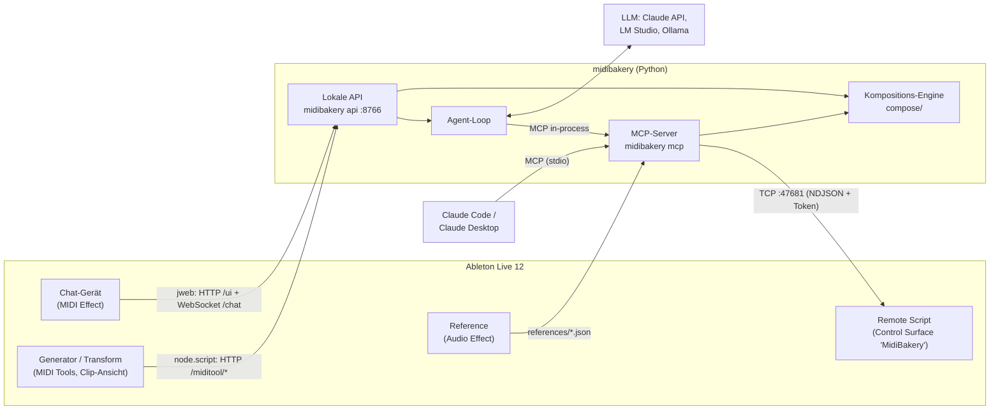

# MidiBakery – wie die Teile zusammenspielen

MidiBakery besteht aus fünf Teilen:

- **Remote Script** in Live: steuert das Live-Set.
- **Core** in Python: Kompositions-Engine, MCP-Server, Agent und lokale API.
- **Chat-Gerät**: Max-for-Live-Gerät für den Chat.
- **Generator** und **Transform**: zwei Max-for-Live-MIDI-Tools in der Clip-Ansicht.
- **Reference**: Max-for-Live-Audio-Effekt, der einen Referenzsong im Arrangement analysiert.

Den Live-Set verändert nur das Remote Script; alle anderen Teile reden mit ihm oder mit der API. Einzige Ausnahme: Die MIDI Tools geben ihre Noten über Lives eigenen MIDI-Tool-Mechanismus zurück.

## Die Teile

| Teil | Wo | Sprache | Gestartet von | Spricht mit |
|---|---|---|---|---|
| Remote Script | `packages/remote_script/MidiBakery` → User Library/Remote Scripts | Python 3.11 (Lives eigener Interpreter, nur Standardbibliothek) | Live, wenn „MidiBakery“ als Control Surface gewählt ist | Live Object Model (LOM); nimmt Verbindungen auf `127.0.0.1:47681` an |
| MCP-Server | `packages/core/src/midibakery/mcp` | Python 3.12 | Claude Code / Desktop (`midibakery mcp`, je Session ein Prozess) | Remote Script |
| Lokale API | `packages/core/src/midibakery/api` | Python 3.12 | das Remote Script beim Laden (`launcher.json`) oder du: `uv run midibakery api --provider …` | Remote Script; LLM-Anbieter; Max-Geräte |
| Chat-Gerät | `packages/m4l` → Presets/MIDI Effects/Max MIDI Effect/MidiBakery | Max-Patch, `jweb` (HTML/JS), Node for Max | Live, wenn das Gerät auf einer Spur liegt | API |
| Generator / Transform | `packages/m4l` → MIDI Tools/Max Generators bzw. Max Transformations | Max-Patch, `v8`, Node for Max | Live, wenn das Tool in der Clip-Ansicht gewählt ist | API |
| Reference | `packages/m4l` → Presets/Audio Effects/Max Audio Effect/MidiBakery | Max-Patch, `v8`, `v8ui`, Node for Max | Live, wenn das Gerät auf einer Spur liegt | Live API; schreibt `references/` |

### Remote Script: die einzige Hand am Live-Set

- Läuft **in** Live und führt atomare Operationen aus, zum Beispiel `song.get`, `track.create`, `notes.apply`, `device.insert` oder `batch`. Der Katalog ist in `catalog/ops.py` definiert, die Prüfliste dazu in `manifest.json`.
- Alle LOM-Zugriffe laufen auf Lives Main-Thread. Ein Socket-Thread nimmt Anfragen an, `update_display()` arbeitet sie etwa alle 100 ms ab.
- Jede schreibende Operation ist ein Undo-Schritt; ein `batch` ist ein gemeinsamer Undo-Schritt.
- Manche Änderungen übernimmt Live erst im nächsten Tick, etwa eine neue Abspielposition. Ops wie `arrangement.locators` und `song.position` laufen deshalb über mehrere Ticks: Der Executor setzt sie einmal pro `update_display()` fort und antwortet, wenn Live die Änderung zeigt. Sie laufen nicht in einem `batch`.
- Beim Start schreibt es Port und Token nach `~/Library/Application Support/MidiBakery/bridge.json` (nur für dich lesbar). Clients lesen diese Datei und melden sich mit dem Token an.
- Mehrere Clients gleichzeitig sind erlaubt: der MCP-Server von Claude Code und die API zum Beispiel. Live arbeitet ihre Aufträge nacheinander ab.
- **Events:** Ein Client kann `{"subscribe": ["state"]}` senden. Dann liest `update_display()` etwa alle 200 ms einen kompakten Zustand (Tempo, Taktart, Scale, Transport, Auswahl, was pro Track spielt, startet oder stoppt) und schickt ihn als `state`-Event, sobald er sich ändert. Abfragen statt LOM-Listener: Es gibt nichts an- und abzumelden, wenn Tracks, Clips oder das Set wechseln. Die API folgt diesen Events und zeigt sie in der Statuszeile des Chats.

### Core: Engine, MCP-Server, Agent, API

- **Kompositions-Engine** (`compose/`): Drums, Bass, Akkorde, Melodie und Transformationen. Sie ist skalen- und taktbewusst, und mit demselben Seed entstehen dieselben Noten. Sie berechnet nur Noten und weiß nichts von Live.
- **MCP-Server** (`mcp/`): stellt 39 Tools für Claude bereit. Die Schemas kommen aus dem Op-Katalog, Kompositions-Tools rufen die Engine auf, und alles, was Live verändert, geht über den Bridge-Client ans Remote Script. Nach Aufgabe:
  - lesen: `get_session` (Song, Spuren, Geräte, Clips, dazu Locators und die Arrangement-Clips jeder Spur), `get_clip`, `get_arrangement`, `get_mixer`, `get_rack`, `get_device_parameters`, `get_drum_pads`, `find_browser_items`, `get_reference`
  - Session und Clips: `set_song`, `transport`, `create_track`/`update_track`/`delete_track`, `create_clip`/`update_clip`/`delete_clip`, `launch_clip`, `create_scene`/`fire_scene`, `edit_notes`, `undo`, `run_batch`
  - Geräte und Mixer: `insert_device`, `load_browser_item`, `set_device_parameter`, `write_clip_envelope`, `update_mixer`, `create_return_track`, `update_rack`, `measure_master`
  - Arrangement: `edit_arrangement` (Clips anlegen, kopieren, verschieben, vertauschen, löschen; Locators setzen und löschen), `compose_takes`
  - Komposition: `compose`, `transform_notes`, `plan_changes`, `plan_song`, `plan_master`, `apply_plan`
  - **Arrangement-Clips per Name:** Wo ein Tool einen Clip braucht (`compose`, `transform_notes`, `delete_clip`, `move_clip`/`swap_clips` in `edit_arrangement`), gibt man statt `slot` den `arrangement_clip` an: seinen Index oder seinen Namen („Groove Bass“; Groß-/Kleinschreibung egal, ein Namensteil genügt, wenn er eindeutig ist). `compose` ersetzt dann die Noten über die ganze Clip-Länge. Ein Clip lässt sich nur verschieben, wenn er nicht getrimmt und kein Loop ist; kein Clip landet auf einem anderen (`CONFLICT`).
  - **Teile eines Clips:** `transform_notes` nimmt `half` (`first` / `second`) oder `from_bar` / `to_bar` (Takte des Clips, 1 = sein erster) und ändert nur dort Noten; `transpose` hat `semitones` (chromatisch, 12 = Oktave) oder `steps` (Skalenstufen), nie beides.
  - **Vorschau und Apply:** `preview=true` an `compose` oder `plan_changes` ändert nichts und liefert ein Diff samt `plan_id`; `apply_plan` schreibt es in einem Undo-Schritt. Hat sich ein Ziel-Clip seit der Planung geändert, scheitert es mit `CONFLICT`. Ein bereits angewendeter Plan meldet `already_applied`, statt zu scheitern. `plan_song` plant einen ganzen Song (siehe `docs/GENRES.md`); auch er wird erst mit `apply_plan` geschrieben. Ebenso `plan_master`, eine Master-Kette aus EQ Eight, Glue Compressor und Limiter mit den belegten Werten des Genres (`docs/GENRES.md`), in zwei Undo-Schritten. `measure_master` liest die Lautheit, die das Gerät MidiBakery Loudness Meter auf dem Master nach BS.1770 misst und zweimal pro Sekunde nach `meter.json` im MidiBakery-Ordner schreibt; `reset=true` legt dort `meter-reset` an, das Gerät löscht es und misst neu. Löschen von Spuren und Clips sowie das Ersetzen von Noten fragen vorher nach; eine Ablehnung kommt als `CANCELLED` zurück.
  - **Take Lanes:** `compose_takes` legt 2 bis 8 Varianten eines Teils (`hook`, `melody`, `bass`, `chords`, `drums`) über dieselben Akkorde in eigene Take Lanes einer Spur im Arrangement (Live 12.2+), ein Undo-Schritt.
  - Tool-Budget für lokale Modelle: Tool-Schemas plus Systemprompt bleiben unter 36.000 Zeichen (geprüft in `tests/test_agent.py`), derzeit etwa 35.800 – das Limit ist fast erreicht. Neue Tools müssen bestehende Schemas teilen oder Platz an anderer Stelle schaffen.
- **Agent-Loop** (`agent/`): ein Gespräch mit einem LLM, also Claude über die Anthropic API, LM Studio oder Ollama. Er ruft **dieselben** MCP-Tools auf, nur in-process statt über stdio. Claude Code und das Chat-Gerät haben damit exakt dieselben Fähigkeiten.
  - **Provider:** `anthropic` (Standard `claude-sonnet-5-5`; wählbar Opus 5.5 und Haiku 5.5), `lmstudio` (OpenAI-kompatibler Server, `LMSTUDIO_HOST`, Standard `127.0.0.1:1234`, Standardmodell `google/gemma-4-e4b`) und `ollama` (`OLLAMA_HOST`, Standard `127.0.0.1:11434`, Standardmodell `qwen3:8b`). Den Claude-Schlüssel liest die App aus dem Schlüsselbund (macOS) bzw. der Anmeldeinformationsverwaltung (Windows); `ANTHROPIC_API_KEY` und ein `ant auth login`-Profil gehen auch.
  - **Compact-Modus** (automatisch für `lmstudio` und `ollama`, `compact=True`): alle Tools, aber mit Kurzbeschreibungen und schlanken Schemas (`compact_tools`: ohne Titel, Grenzen und Discriminator, Beschreibung nur der erste Satz; `if_exists` ist ausgeblendet, damit kleine Modelle nicht ungefragt überschreiben) und kürzeren Ergebnissen (`COMPACT_RESULTS`: `get_session` als wenige Textzeilen mit freien Slots). Die erste Nachricht eines Gesprächs bringt die Session gleich mit; jede Nachricht trägt eine Spracherinnerung (Deutsch oder Englisch, sonst „Antworte in der Sprache dieser Nachricht“). Arguments, die ein Tool nicht kennt, werden benannt statt still verworfen (mit „meintest du …?“), und von Modellen erfundene Schachtelungen werden angehoben (`lift_nested`).
  - **Absicherungen** (`loop.py`): Behauptet ein lokales Modell eine Änderung, ohne ein Tool aufgerufen zu haben, oder scheitert ein Schreib-Tool und wird nicht wiederholt, bekommt es einmal pro Nachricht einen Hinweis; eine leere Antwort wird einmal nachgefragt. Dasselbe Scheitern dreimal oder sechs Runden nur mit Fehlern beenden die Nachricht mit dem Code `STUCK`; nach 24 Tool-Runden endet sie ebenfalls. Eine vom Nutzer abgelehnte Änderung (`CANCELLED`) zählt nicht als Fehler.
  - **UI-Tools:** `apply_plan` und `undo` darf die Chat-Seite selbst auslösen (Buttons Apply, Undo); das Modell erfährt es mit der nächsten Nachricht und wendet nicht doppelt an.
  - Zwei Systemprompts: `SYSTEM_PROMPT` (voll) und `SMALL_SYSTEM_PROMPT` für 8k-Kontext. `tools=small` bzw. `--small` nimmt dazu nur 12 Tools, `tools=reduced` bzw. `--reduced` 13 (`REDUCED_TOOLS`, `SMALL_TOOLS` in `agent/tools.py`).
  - **LM Studio** lädt ein Modell beim ersten Gebrauch mit dessen Standard-Kontext (oft 4k oder 8k), zu klein für die Tools. Der Provider erkennt das und rät zu `lms load <modell> -c 32768`. Das Modell-Menü listet geladene Modelle (ohne Embedding-Modelle) von LM Studio und Ollama; ist keiner erreichbar, fehlen sie einfach.
  - Der Server-Prozess schreibt jede Nutzernachricht und jeden Tool-Aufruf (Eingabe gekürzt, Ergebnis ok/Fehler) mit Zeitstempel in den Log (`midibakery.agent`), siehe `api.log` unten.
- **Lokale API** (`api/`, `127.0.0.1:8766`): das Tor für die Max-Geräte. Das Remote Script startet sie als eigenen Prozess, wenn Live es lädt, und beendet sie mit Live. In Lives Python läuft sie nicht: Sie braucht Python 3.12 und Pakete außerhalb der Standardbibliothek. Läuft auf dem Port schon eine API, etwa von Hand gestartet, bleibt es bei dieser.
  - `GET /ui`: die Chat-Seite (ohne Geheimnisse, `Cache-Control: no-store`)
  - `WS /chat`: der Agent im Chat (Query `provider`, `model`, `tools`); Ereignisse `ready`, `text`, `thinking`, `tool_call`, `tool_result`, `plan`, `confirm`, `live_state`, `done`, `error`; Nachrichten `user`, `tool`, `confirm_reply`, `cancel`, `reset`
  - `GET /models`: die Modellauswahl (Claude-Modelle plus erreichbare lokale)
  - `GET|PUT|DELETE /auth/anthropic`: Claude-Schlüssel prüfen, speichern, löschen; er wird nie zurückgeschickt
  - `GET /update`, `POST /update/install`: Update-Stand und Installation
  - `GET /license`, `POST /license/{trial|activate|deactivate}`: Lizenz
  - `POST /miditool/generate` und `/miditool/transform`: die Engine für die MIDI Tools
  - `GET /health`: Version, Prozess-ID, Zustand von Live, Update, Lizenz
  Port und Token stehen in `api.json`; jede Anfrage braucht den Token. Ist die Lizenzprüfung aktiv und die Lizenz nicht gültig, antwortet der Chat vor dem Modell mit `LICENSE_REQUIRED`.

### Chat-Gerät

- Ein MIDI-Effekt auf einer beliebigen MIDI-Spur; MIDI läuft unverändert durch.
- Links zeigt `jweb` (eingebetteter Browser) die Chat-Seite `/ui`. Der Token steckt im URL-Fragment `#token=…`, das der Browser nie an den Server schickt.
- Die Chat-Seite hat: Modell-Menü, **Stop**, **Undo** (nimmt die letzte Änderung in Live zurück), **Key** (nur bei Claude-Modellen), **Copy** (das ganze Gespräch in die Zwischenablage; ein Klick auf eine einzelne Antwort kopiert sie), **New** (Gespräch vergessen), eine Statuszeile mit dem Live-Zustand, Plan-Karten mit **Apply** (Noten-Diff als Piano Roll, bei Songs eine Zeitleiste) und die Banner für Update und Lizenz. Lokale Modelle brauchen keinen Schlüssel.
- Rechts liegen native Max-Bedienelemente, weil Live keine Tastatur an `jweb` weiterreicht und Dropdowns darin nicht aufgehen:
  - **Model-Menü** (`umenu`): Die Seite füllt es mit der Liste aus `/models`, die Auswahl geht als `model_index` zurück.
  - **Eingabefeld** (`textedit`): Enter schickt den Text als `chat_input` an die Seite, danach bekommt das Feld den Fokus zurück.
  - **Pop out** öffnet dieselbe Seite im Browser.
- `node.script midibakery-chat.js` liest `api.json`, gibt `jweb` die URL und sendet sie erneut, bis die Seite „loaded“ meldet. Ändert sich der Token, etwa bei einem Neustart der API, lädt es die Seite automatisch neu.

### Generator und Transform (MIDI Tools)

- Sie erscheinen in der Clip-Ansicht unter **Generate** bzw. **Transform** und arbeiten auf dem markierten Zeitbereich in der Skala des Clips.
- Live verlangt pro Apply-Zyklus eine **synchrone** Antwort, die Noten kommen aber per HTTP von der API. Deshalb arbeitet der eingebettete `v8`-Code in zwei Durchgängen:
  1. **Sofort antworten:** mit gecachtem Ergebnis, sonst mit „nichts ändern“.
  2. **Anfrage stellen:** Der Request geht über `node.script midibakery-miditool.js` an die API, und zwar als Max-Dictionary, nicht als Nachricht, weil die Noten eines Clips zu groß dafür sind.
  3. **Erneut auslösen:** Kommt die Antwort, wird sie gecacht, und das Tool löst sich selbst noch einmal aus, außerhalb von Lives Apply-Aufruf. Live übernimmt dann das Ergebnis.
- **Generator:** Ein Generator kann in Live nur hinzufügen. **Replace** (Standard: an) leert den Zeitbereich deshalb vorher über die Live API, einmal pro Apply-Zyklus. Innerhalb eines Zyklus, also beim Drehen an Reglern oder bei Dice, ersetzt Live das eigene Zwischenergebnis immer selbst.
- **Transform:** Die Operation läuft über Note-IDs, Eigenschaften wie Probability bleiben erhalten. Ändert sie nichts, steht der Grund in der Statuszeile.
- Diese Tools benutzen das Remote Script nicht. Sie bekommen die Noten von Live und geben sie an Live zurück; die API rechnet nur.

### Reference (Audio Effect)

- Liegt auf der Audiospur mit dem Referenzsong. Der `v8`-Code sucht über die Live API den längsten Audio-Clip im Arrangement der Spur und liest Datei, Lage, Start-Marker und Warp-Marker.
- `node.script midibakery-reference.js` dekodiert die Datei mit `afconvert` (22,05 kHz mono) und analysiert sie in `reference-analysis.js`, bei gewarpten Clips auf Lives Beat-Raster aus den Warp-Markern, bei ungewarpten auf einem eigenen Raster (Tempo aus dem stärksten Achtel-Puls, Zählzeit eins dort, wo die Tiefen steigen): Energie in vier Bändern pro Takt, Kick aus wiederkehrenden Anstiegen der Tiefen, Tonart aus Chroma und Bass, Abschnitte in 8-Takt-Schritten mit Namen (Intro, Build, Drop, Break, Outro).
- Das **Genre**-Menü (Auto oder eines von `plan_song`) bestimmt Abschnittsnamen und Phrasenlänge und klärt halbes oder doppeltes Tempo. Vier **Sensitivity**-Felder (0–100, Standard 50; Kick, Lows, Mids, Hats, je auf Höhe der Spur in der Ansicht) steuern, wie fein der Song geteilt wird: Ihr Mittelwert wirkt wie ein Regler (bei 100 ist jede gefundene Änderung ein Abschnitt, niedriger verschmelzen gleichartige Nachbarn), ihr Verhältnis gewichtet die Bänder. **Lock** verschiebt alle Felder gemeinsam. Die Analyse läuft neu, sobald die Felder ruhen. Die Änderungen innerhalb eines verschmolzenen Abschnitts bleiben als `phrases` in der Analyse. Ein ungewarpter Clip wird vorher auf Lives Raster gewarpt (Tempo des Sets unverändert).
- Das Ergebnis zeigt ein `v8ui` an und es landet in `references/<hash>.json`; das MCP-Tool `get_reference` liest es. **Set Locators** setzt nacheinander Locators an die Abschnitte, **Remove Locators** entfernt alle Locators im Bereich des Clips. Live setzt und entfernt Locators nur an der Abspielposition und rastet sie dabei aufs sichtbare Raster ein, deshalb ein Task mit Ticks, der neue und verschwundene Locators an ihren IDs erkennt; der Transport muss stehen.
- Weder API noch Remote Script sind nötig.

## Welcher Prozess hostet was

| Prozess | Gestartet von | Was darin läuft | Ports / Verbindungen |
|---|---|---|---|
| **Ableton Live** | du | Remote Script (Lives Python); Max for Live mit den Patches der drei Geräte und dem `v8`-Code der MIDI Tools | lauscht auf `127.0.0.1:47681` |
| **Max Helper (Renderer)** (Kind von Live) | Live/Max | Chromium für `jweb`: die Chat-Seite und ihr WebSocket | → `:8766` |
| **N4M PM** → je ein **node** pro `node.script` (Kinder von Live) | Node for Max | `midibakery-chat.js` bzw. `midibakery-miditool.js`: Discovery über `api.json`, HTTP der MIDI Tools | → `:8766` |
| **`midibakery api`** | du (Terminal) | lokale API **plus** Agent-Loop, Kompositions-Engine und eine eigene MCP-Server-Instanz, die der Agent direkt im Prozess aufruft | lauscht auf `127.0.0.1:8766`; → `:47681`; → LLM (Claude API, LM Studio `:1234`, Ollama `:11434`) |
| **`midibakery mcp`** (einer pro Claude-Code-/Desktop-Session) | Claude-App | MCP-Server für Claude über stdio, mit eigener Engine | → `:47681`, erst beim ersten Tool-Aufruf |

Der MCP-Code läuft also mehrfach: in der API für den Chat und je Claude-Session als eigener Prozess. Alle Instanzen sind Clients desselben Remote Scripts, das ihre Aufträge in Live nacheinander abarbeitet. Ein `midibakery mcp` läuft mit dem Code des Ordners, in dem die Claude-Session gestartet wurde; Sessions in einem Worktree nutzen also dessen Stand.

## Drei typische Abläufe

**1. Claude Code komponiert:** „Leg auf Spur 1 vier Takte House-Drums an.“

1. Claude ruft das MCP-Tool `compose` mit `kind: "drums"` auf.
2. Der MCP-Server liest per `song.get` und `tracks.list` die Session (Tempo, Skala, Drum-Rack-Pads), und die Engine erzeugt die Noten.
3. Der MCP-Server schickt einen `batch` mit `clip.create` und `notes.apply` ans Remote Script.
4. Live legt den Clip in einem einzigen Undo-Schritt an.

**2. Chat im Gerät:** gleicher Wunsch, im Chat-Gerät getippt.

1. `textedit` schickt `chat_input` an die Seite, die Seite per WebSocket an die API.
2. Der Agent fragt das gewählte LLM, und das LLM ruft `compose` mit `kind: "drums"` auf.
3. Von hier an ist es derselbe Weg wie in Ablauf 1, nur in-process.
4. Destruktive Änderungen fragt die Seite mit „Apply / Cancel“ ab.

**3. MIDI Tool:** Generator → Drums → Generate.

1. Live übergibt Zeitbereich, Skala und Noten an `v8`, und `v8` antwortet sofort leer.
2. Über Node geht `POST /miditool/generate` an die API, die Engine liefert Noten, und `v8` cached sie.
3. Bei aktivem Replace leert `v8` den Bereich, dann löst es das Tool erneut aus und Live fügt die Noten ein.

## Installer, Updates, Lizenz

- **Paket:** `packaging/build_app.py` friert `midibakery` mit Python und der Nutzlast (Remote Script, gebaute Geräte) per PyInstaller in einen Ordner ein. Darauf bauen `packaging/macos/build_pkg.py` (`.pkg`, Apple Silicon; Intel auf Release-Tags und PRs mit Label `intel`) und `packaging/windows/build_setup.py` (Inno Setup 6, `midibakery.iss`). Beide installieren ohne Administrator für den aktuellen Benutzer (macOS: `~/Library/Application Support/MidiBakery/runtime/<version>/`, Windows: `%LOCALAPPDATA%\Programs\MidiBakery\runtime\<version>\`) und rufen dann `midibakery install` auf. Beide Installer sind noch nicht signiert bzw. notarisiert. CI (`.github/workflows/package.yml`) baut sie und testet Installieren, Aktualisieren und Deinstallieren (`packaging/smoke.py`, `check_pkg.py`, `check_setup.py`).
- **Update-Dienst:** Cloudflare Worker, R2 und D1 auf `updates.klirrwerk.com` (`services/updates`, siehe dessen README). Die App vertraut einem Manifest nur mit gültiger Ed25519-Signatur (`UPDATE_KEYS` in `updates.py`) und führt einen Installer nur bei passender SHA-256 aus. Ein Tag `v<version>` veröffentlicht ein Release.
- **Lizenz:** gebaut, aber **ausgeschaltet**: Solange `LICENSE_KEYS` in `license.py` leer ist, ist alles erlaubt. Danach gilt: 30 Tage Testphase, dann Lizenzschlüssel (dauerhaft, 12 Monate Updates, zwei Rechner), vom Dienst signierte Token, offline geprüft. Ohne gültigen Token liest die App Live und macht Undo, erzeugt und ändert aber nichts.

## Starten und aktualisieren

| Was | Wann nötig | Wie |
|---|---|---|
| Remote Script und Max-Geräte | einmalig; nach Änderungen am Remote Script oder in `packages/m4l` | `uv run midibakery install` (baut die Geräte, installiert beides; `--link` verlinkt das Remote Script), dann Live neu starten bzw. Gerät neu laden. Beim ersten Mal „MidiBakery“ als Control Surface wählen |
| Lokale API | für die Max-Geräte; nach Änderungen im Core | `uv run midibakery api --provider lmstudio` (oder `anthropic`, `ollama`), danach neu starten. Die Geräte übernehmen den neuen Token selbst. |
| Chat-Seite | nach Änderungen an `chat.html` | Die API liefert sie neu aus; das Chat-Gerät muss neu geladen werden (löschen und neu einfügen). |
| Installierte Version (Paket) | wenn eine neue erscheint | Die API fragt einmal am Tag bei `updates.klirrwerk.com` nach; About-Zeile und Chat-Gerät zeigen das Update, *Install* lädt den Installer, prüft ihn gegen das signierte Manifest und öffnet ihn. Im Terminal: `midibakery update`. Details: `services/updates/README.md` |
| MCP für Claude Code | einmalig | `claude mcp add midibakery -- uv --directory <Repo> run midibakery mcp`; nach Core-Änderungen eine neue Claude-Code-Session starten |

## Wo man nachsieht, wenn etwas hakt

| Datei / Ort | Inhalt |
|---|---|
| `~/Library/Application Support/MidiBakery/bridge.json` | Port und Token des Remote Scripts; fehlt die Datei, läuft es nicht |
| `~/Library/Application Support/MidiBakery/api.json` | Port und Token der API |
| `~/Library/Application Support/MidiBakery/device-chat.log` | Chat-Gerät: gesendete URLs, Meldungen von `jweb`, Seitengröße (Token geschwärzt) |
| `~/Library/Application Support/MidiBakery/device-miditool.log` | Generator/Transform: Anfragen, Antwortzeiten, Fehler mit Schritt |
| `~/Library/Application Support/MidiBakery/device-reference.log` | Reference: analysierte Clips, Dauer, Fehler |
| `~/Library/Application Support/MidiBakery/references/` | Analysen des Reference-Geräts |
| `~/Library/Application Support/MidiBakery/api.log` | die API, wenn Live sie gestartet hat: Zeitstempel, jede Nutzernachricht und jeder Tool-Aufruf mit Fehler. Hier liest man nach, warum ein Chat danebenging. Unter Windows `%APPDATA%\MidiBakery\api.log` |
| `…/MidiBakery/launcher.json` | wie das Remote Script die API startet (Befehl, Port); fehlt sie, startet keine API mit Live |
| `…/MidiBakery/installed.json` | jeder Pfad, den `install` geschrieben hat; `uninstall` entfernt genau diese |
| `…/MidiBakery/settings.json`, `update.json`, `license.json` | Einstellungen (z. B. Update-Check aus), letzter Update-Stand, Lizenz-Token |
| Terminal mit `midibakery api` | bei von Hand gestarteter API: Aufrufe an LM Studio/Ollama, Fehler der API, derselbe Log wie in `api.log` |
| Lives `Log.txt` | Meldungen des Remote Scripts (`MidiBakery: …`) |
| `uv run midibakery ping` | prüft die Verbindung zum Remote Script |

## Sicherheit in Kürze

- Alles bindet nur an `127.0.0.1`.
- Remote Script und API verlangen jeweils einen zufälligen Token aus einer Datei, die nur dein Benutzer lesen kann.
- Die Chat-Seite enthält keinen Token; das Gerät übergibt ihn im URL-Fragment.
- Logs schwärzen den Token.
- Lizenz: Testphase und Lizenz sind vom Dienst signierte Tokens, die die App offline prüft; gebunden an einen Hash der Rechner-ID, nichts Persönliches. Ohne Lizenz bleiben Lesen und Undo möglich, ein Set wird nie verändert.
- Updates: Ein Installer wird nur geöffnet, wenn das Manifest mit einem in der App hinterlegten Ed25519-Schlüssel signiert ist und die SHA-256 der Datei passt. Der Update-Check schickt nur Version, System, Architektur und Kanal; `midibakery update --disable` schaltet ihn ab.
- Cloud-LLMs (Claude) bekommen Session-Informationen wie Spurnamen, Noten und Tempo. Mit LM Studio oder Ollama bleibt alles lokal.
