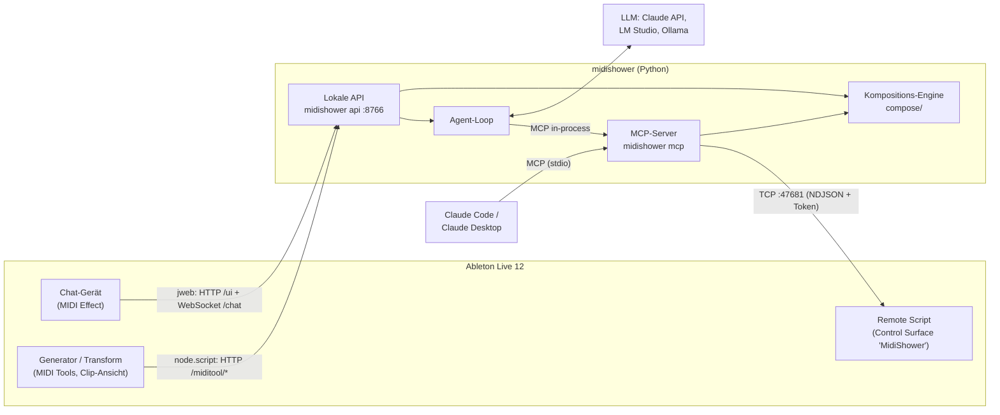

# MidiShower – wie die Teile zusammenspielen

MidiShower besteht aus fünf Teilen:

- **Remote Script** in Live: steuert das Live-Set.
- **Core** in Python: Kompositions-Engine, MCP-Server, Agent und lokale API.
- **Chat-Gerät**: Max-for-Live-Gerät für den Chat.
- **Generator** und **Transform**: zwei Max-for-Live-MIDI-Tools in der Clip-Ansicht.

Den Live-Set verändert nur das Remote Script; alle anderen Teile reden mit ihm oder mit der API. Einzige Ausnahme: Die MIDI Tools geben ihre Noten über Lives eigenen MIDI-Tool-Mechanismus zurück.

## Die Teile

| Teil | Wo | Sprache | Gestartet von | Spricht mit |
|---|---|---|---|---|
| Remote Script | `packages/remote_script/MidiShower` → User Library/Remote Scripts | Python 3.11 (Lives eigener Interpreter, nur Standardbibliothek) | Live, wenn „MidiShower“ als Control Surface gewählt ist | Live Object Model (LOM); nimmt Verbindungen auf `127.0.0.1:47681` an |
| MCP-Server | `packages/core/src/midishower/mcp` | Python 3.12 | Claude Code / Desktop (`midishower mcp`, je Session ein Prozess) | Remote Script |
| Lokale API | `packages/core/src/midishower/api` | Python 3.12 | du: `uv run midishower api --provider …` | Remote Script; LLM-Anbieter; Max-Geräte |
| Chat-Gerät | `packages/m4l` → Presets/MIDI Effects/Max MIDI Effect/MidiShower | Max-Patch, `jweb` (HTML/JS), Node for Max | Live, wenn das Gerät auf einer Spur liegt | API |
| Generator / Transform | `packages/m4l` → MIDI Tools/Max Generators bzw. Max Transformations | Max-Patch, `v8`, Node for Max | Live, wenn das Tool in der Clip-Ansicht gewählt ist | API |

### Remote Script: die einzige Hand am Live-Set

- Läuft **in** Live und führt atomare Operationen aus, zum Beispiel `song.get`, `track.create`, `notes.apply`, `device.insert` oder `batch`. Der Katalog ist in `catalog/ops.py` definiert, die Prüfliste dazu in `manifest.json`.
- Alle LOM-Zugriffe laufen auf Lives Main-Thread. Ein Socket-Thread nimmt Anfragen an, `update_display()` arbeitet sie etwa alle 100 ms ab.
- Jede schreibende Operation ist ein Undo-Schritt; ein `batch` ist ein gemeinsamer Undo-Schritt.
- Beim Start schreibt es Port und Token nach `~/Library/Application Support/MidiShower/bridge.json` (nur für dich lesbar). Clients lesen diese Datei und melden sich mit dem Token an.
- Mehrere Clients gleichzeitig sind erlaubt: der MCP-Server von Claude Code und die API zum Beispiel. Live arbeitet ihre Aufträge nacheinander ab.

### Core: Engine, MCP-Server, Agent, API

- **Kompositions-Engine** (`compose/`): Drums, Bass, Akkorde, Melodie und Transformationen. Sie ist skalen- und taktbewusst, und mit demselben Seed entstehen dieselben Noten. Sie berechnet nur Noten und weiß nichts von Live.
- **MCP-Server** (`mcp/`): stellt rund 27 Tools für Claude bereit, darunter `get_session`, `compose_drums`, `edit_notes`, `plan_changes` und `apply_plan`. Die Schemas kommen aus dem Op-Katalog, Kompositions-Tools rufen die Engine auf, und alles, was Live verändert, geht über den Bridge-Client ans Remote Script.
- **Agent-Loop** (`agent/`): ein Gespräch mit einem LLM, also Claude über die Anthropic API, LM Studio oder Ollama. Er ruft **dieselben** MCP-Tools auf, nur in-process statt über stdio. Claude Code und das Chat-Gerät haben damit exakt dieselben Fähigkeiten. Kleine lokale Modelle bekommen eine reduzierte Tool-Auswahl.
- **Lokale API** (`api/`, `127.0.0.1:8766`): das Tor für die Max-Geräte.
  - `GET /ui`: die Chat-Seite (ohne Geheimnisse)
  - `WS /chat`: der Agent im Chat
  - `GET /models`: die Modellauswahl
  - `POST /miditool/generate` und `/miditool/transform`: die Engine für die MIDI Tools
  - `GET /health`
  Port und Token stehen in `api.json`; jede Anfrage braucht den Token.

### Chat-Gerät

- Ein MIDI-Effekt auf einer beliebigen MIDI-Spur; MIDI läuft unverändert durch.
- Links zeigt `jweb` (eingebetteter Browser) die Chat-Seite `/ui`. Der Token steckt im URL-Fragment `#token=…`, das der Browser nie an den Server schickt.
- Rechts liegen native Max-Bedienelemente, weil Live keine Tastatur an `jweb` weiterreicht und Dropdowns darin nicht aufgehen:
  - **Model-Menü** (`umenu`): Die Seite füllt es mit der Liste aus `/models`, die Auswahl geht als `model_index` zurück.
  - **Eingabefeld** (`textedit`): Enter schickt den Text als `chat_input` an die Seite, danach bekommt das Feld den Fokus zurück.
  - **Pop out** öffnet dieselbe Seite im Browser.
- `node.script midishower-chat.js` liest `api.json`, gibt `jweb` die URL und sendet sie erneut, bis die Seite „loaded“ meldet. Ändert sich der Token, etwa bei einem Neustart der API, lädt es die Seite automatisch neu.

### Generator und Transform (MIDI Tools)

- Sie erscheinen in der Clip-Ansicht unter **Generate** bzw. **Transform** und arbeiten auf dem markierten Zeitbereich in der Skala des Clips.
- Live verlangt pro Apply-Zyklus eine **synchrone** Antwort, die Noten kommen aber per HTTP von der API. Deshalb arbeitet der eingebettete `v8`-Code in zwei Durchgängen:
  1. **Sofort antworten:** mit gecachtem Ergebnis, sonst mit „nichts ändern“.
  2. **Anfrage stellen:** Der Request geht über `node.script midishower-miditool.js` an die API, und zwar als Max-Dictionary, nicht als Nachricht, weil die Noten eines Clips zu groß dafür sind.
  3. **Erneut auslösen:** Kommt die Antwort, wird sie gecacht, und das Tool löst sich selbst noch einmal aus, außerhalb von Lives Apply-Aufruf. Live übernimmt dann das Ergebnis.
- **Generator:** Ein Generator kann in Live nur hinzufügen. **Replace** (Standard: an) leert den Zeitbereich deshalb vorher über die Live API, einmal pro Apply-Zyklus. Innerhalb eines Zyklus, also beim Drehen an Reglern oder bei Dice, ersetzt Live das eigene Zwischenergebnis immer selbst.
- **Transform:** Die Operation läuft über Note-IDs, Eigenschaften wie Probability bleiben erhalten. Ändert sie nichts, steht der Grund in der Statuszeile.
- Diese Tools benutzen das Remote Script nicht. Sie bekommen die Noten von Live und geben sie an Live zurück; die API rechnet nur.

## Drei typische Abläufe

**1. Claude Code komponiert:** „Leg auf Spur 1 vier Takte House-Drums an.“

1. Claude ruft das MCP-Tool `compose_drums` auf.
2. Der MCP-Server liest per `song.get` und `tracks.list` die Session (Tempo, Skala, Drum-Rack-Pads), und die Engine erzeugt die Noten.
3. Der MCP-Server schickt einen `batch` mit `clip.create` und `notes.apply` ans Remote Script.
4. Live legt den Clip in einem einzigen Undo-Schritt an.

**2. Chat im Gerät:** gleicher Wunsch, im Chat-Gerät getippt.

1. `textedit` schickt `chat_input` an die Seite, die Seite per WebSocket an die API.
2. Der Agent fragt das gewählte LLM, und das LLM ruft `compose_drums` auf.
3. Von hier an ist es derselbe Weg wie in Ablauf 1, nur in-process.
4. Destruktive Änderungen fragt die Seite mit „Apply / Cancel“ ab.

**3. MIDI Tool:** Generator → Drums → Generate.

1. Live übergibt Zeitbereich, Skala und Noten an `v8`, und `v8` antwortet sofort leer.
2. Über Node geht `POST /miditool/generate` an die API, die Engine liefert Noten, und `v8` cached sie.
3. Bei aktivem Replace leert `v8` den Bereich, dann löst es das Tool erneut aus und Live fügt die Noten ein.

## Starten und aktualisieren

| Was | Wann nötig | Wie |
|---|---|---|
| Remote Script | einmalig; nach Änderungen am Remote Script | `uv run midishower install-script`, dann Live neu starten und „MidiShower“ als Control Surface wählen |
| Lokale API | für die Max-Geräte; nach Änderungen im Core | `uv run midishower api --provider lmstudio` (oder `anthropic`, `ollama`), danach neu starten. Die Geräte übernehmen den neuen Token selbst. |
| Max-Geräte | nach Änderungen in `packages/m4l` | `uv run python packages/m4l/build.py --install`, dann Gerät/Tool in Live neu laden |
| Chat-Seite | nach Änderungen an `chat.html` | Die API liefert sie neu aus; das Chat-Gerät muss neu geladen werden (löschen und neu einfügen). |
| MCP für Claude Code | einmalig | `claude mcp add midishower -- uv --directory <Repo> run midishower mcp`; nach Core-Änderungen eine neue Claude-Code-Session starten |

## Wo man nachsieht, wenn etwas hakt

| Datei / Ort | Inhalt |
|---|---|
| `~/Library/Application Support/MidiShower/bridge.json` | Port und Token des Remote Scripts; fehlt die Datei, läuft es nicht |
| `~/Library/Application Support/MidiShower/api.json` | Port und Token der API |
| `~/Library/Application Support/MidiShower/device-chat.log` | Chat-Gerät: gesendete URLs, Meldungen von `jweb`, Seitengröße (Token geschwärzt) |
| `~/Library/Application Support/MidiShower/device-miditool.log` | Generator/Transform: Anfragen, Antwortzeiten, Fehler mit Schritt |
| Terminal mit `midishower api` | Aufrufe an LM Studio/Ollama, Fehler der API |
| Lives `Log.txt` | Meldungen des Remote Scripts (`MidiShower: …`) |
| `uv run midishower ping` | prüft die Verbindung zum Remote Script |

## Sicherheit in Kürze

- Alles bindet nur an `127.0.0.1`.
- Remote Script und API verlangen jeweils einen zufälligen Token aus einer Datei, die nur dein Benutzer lesen kann.
- Die Chat-Seite enthält keinen Token; das Gerät übergibt ihn im URL-Fragment.
- Logs schwärzen den Token.
- Cloud-LLMs (Claude) bekommen Session-Informationen wie Spurnamen, Noten und Tempo. Mit LM Studio oder Ollama bleibt alles lokal.
